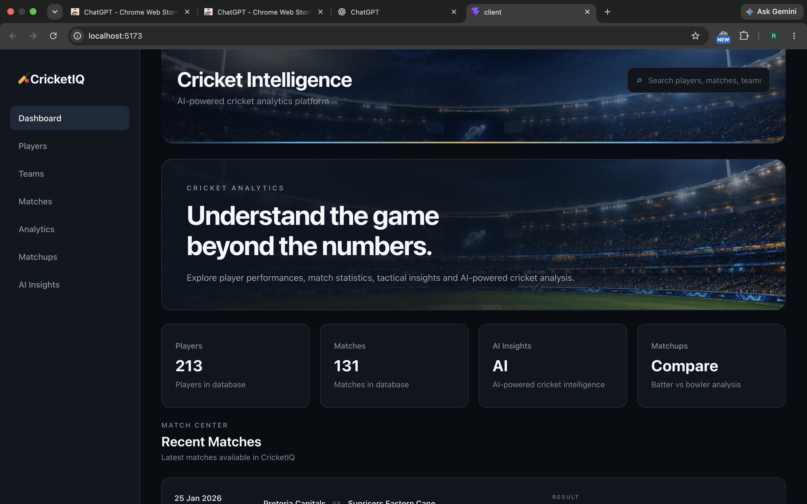

# CricketIQ — AI Cricket Analyst

CricketIQ is a full-stack cricket analytics application for exploring player, team, match, and ball-by-ball data. It combines an interactive React dashboard with an Express API, MongoDB storage, statistical analysis, and AI-generated cricket explanations.

> **Project status:** local development project. The frontend currently calls the API at `http://localhost:8000/api`; deployment configuration is not included.

## Contents

- [What it does](#what-it-does)
- [Screenshots and visuals](#screenshots-and-visuals)
- [Technology](#technology)
- [Repository layout](#repository-layout)
- [Requirements](#requirements)
- [Run locally](#run-locally)
- [Import the included match data](#import-the-included-match-data)
- [API overview](#api-overview)
- [Data model](#data-model)
- [Configuration and security](#configuration-and-security)
- [Troubleshooting](#troubleshooting)

## What it does

- **Dashboard:** summary cards, recent matches, top batters, and top bowlers.
- **Player explorer and profiles:** browse player records and inspect batting and bowling statistics, performance trends, and phase-by-phase analysis.
- **Match center:** browse matches and view match analytics and AI-generated match summaries.
- **Team directory:** browse the teams represented in the database.
- **Matchups:** compare a batter with a bowler and explore matchup and phase analysis.
- **AI insights:** request player, match, and matchup explanations generated with Google Gemini.
- **Charts:** visualize analytics in the React client with Recharts.

The exact records shown depend on the data imported into MongoDB. The repository includes 130 SA20 ball-by-ball JSON match files under `data/sa20`.

## Screenshots and visuals

### Dashboard



The dashboard uses the stadium artwork in `client/public/images/` for its cricket-themed header and hero.

## Technology

| Area | Stack |
| --- | --- |
| Frontend | React 19, Vite 8, Recharts |
| Backend | Node.js, Express 5 |
| Database | MongoDB with Mongoose |
| Generative AI | Google GenAI SDK (Gemini) |
| Match data | JSON files in Cricsheet-style format, in `data/sa20` |

## Repository layout

```text
CRICKET-IQ/
├── client/                 # React + Vite application
│   ├── public/images/      # Stadium and cricket artwork
│   └── src/
│       ├── components/     # Shared interface components
│       ├── pages/          # Dashboard, players, teams, matches, analytics
│       └── services/       # Frontend API calls
├── server/                 # Express API and MongoDB models
│   ├── config/             # Database connection
│   ├── controllers/        # Route handlers
│   ├── models/             # Player, Team, Match, Innings, Delivery
│   ├── routes/             # REST API routes
│   └── services/           # Import, analytics, and AI logic
├── data/sa20/              # Included match JSON files
├── docs/                   # Supporting project documentation
└── README.md
```

## Requirements

- Node.js and npm
- MongoDB running locally or a MongoDB connection string
- A Google Gemini API key for AI-powered summaries and insights

Install dependencies separately in the frontend and backend folders; each has its own `package.json` and lockfile.

## Run locally

1. Clone the repository and enter its directory:

   ```bash
   git clone https://github.com/rohitkakade23/CricketIQ-AI-Cricket-Analyst.git
   cd CricketIQ-AI-Cricket-Analyst
   ```

2. Create `server/.env` (this file is ignored by Git) and set your local MongoDB URI and Gemini key:

   ```env
   PORT=8000
   MONGO_URI=mongodb://127.0.0.1:27017/cricketiq
   GEMINI_API_KEY=your_gemini_api_key
   ```

   Use your own MongoDB URI and API key. Never commit real credentials.

3. Install backend dependencies and start the API in one terminal:

   ```bash
   cd server
   npm install
   npm run dev
   ```

   The API listens on `http://localhost:8000`. Its health endpoint is `http://localhost:8000/api/health`.

4. In a second terminal, install and start the client:

   ```bash
   cd client
   npm install
   npm run dev
   ```

   Open the local URL printed by Vite (normally `http://localhost:5173`). Keep MongoDB and both development servers running while using the app.

5. Import the included match data as described below if the database is empty.

## Import the included match data

With MongoDB available and `server/.env` configured, run the importer from the backend directory:

```bash
cd server
node import.js
```

The importer reads JSON files from `data/sa20`, parses each match, and writes its match and ball-by-ball records to MongoDB. It logs individual import failures and continues processing the remaining files. It skips matches whose external match ID is already present. If an import is interrupted partway through a match, inspect the database before rerunning the importer because the existing-match check may skip that match on a later run.

## API overview

The backend is mounted under `/api` and defaults to port `8000`.

| Method | Endpoint | Purpose |
| --- | --- | --- |
| `GET` | `/api/health` | Check that the API process is running |
| `GET` | `/api/players` | List players |
| `POST` | `/api/players` | Create a player record |
| `GET` | `/api/players/top-performers` | Get top batters |
| `GET` | `/api/players/top-bowlers` | Get top bowlers |
| `GET` | `/api/players/:id` | Get a player |
| `GET` | `/api/players/:id/stats` | Get player statistics |
| `GET` | `/api/players/:id/performance` | Get player performance data |
| `GET` | `/api/players/:id/phase-analysis` | Analyze batting by match phase |
| `GET` | `/api/players/:id/bowling-stats` | Get bowling statistics |
| `GET` | `/api/players/:id/bowling-phase-analysis` | Analyze bowling by match phase |
| `GET` | `/api/players/:id/handedness-analysis` | Analyze bowling against batter handedness |
| `GET` | `/api/players/:id/ai-summary` | Generate an AI player summary |
| `GET` | `/api/players/:id/ai-insights` | Generate AI player insights |
| `GET` | `/api/players/compare/:player1Id/:player2Id` | Compare two players |
| `GET` | `/api/players/matchup/:batterId/:bowlerId` | Analyze a batter-bowler matchup |
| `GET` | `/api/players/matchup/:batterId/:bowlerId/phase-analysis` | Analyze the matchup by phase |
| `GET` | `/api/players/matchup/:batterId/:bowlerId/ai` | Generate AI matchup insights |
| `GET` | `/api/matches` | List matches |
| `GET` | `/api/matches/:id` | Get a match |
| `GET` | `/api/matches/:id/analytics` | Get match analytics |
| `GET` | `/api/matches/:id/ai-summary` | Generate an AI match summary |
| `GET` | `/api/teams` | List teams |

AI endpoints require a working Gemini API key. The client API base URL is currently set directly in `client/src/services/dashboardApi.js` to `http://localhost:8000/api`.

## Data model

- **Player:** identity and cricket attributes such as country, role, batting hand, and bowling style.
- **Team:** team identity and related records.
- **Match:** competition, season, teams, format, venue, date, and result.
- **Innings:** innings-level match data.
- **Delivery:** ball-by-ball outcomes and statistics used for player and matchup analysis.

## Configuration and security

- `server/.env` is the backend environment file and is excluded by `.gitignore`.
- Keep API keys, database credentials, and any other secrets out of source control.
- MongoDB must be reachable before database-backed routes and data import can work. The health endpoint checks the API process, not the database or the presence of imported data.
- The Vite client currently uses a fixed local API URL. Update its API configuration before deploying the frontend and backend to separate hosts.
- Player images and other public artwork belong in the client’s public assets; do not place private credentials or user data there.

## Troubleshooting

| Symptom | Check |
| --- | --- |
| API exits during startup | Confirm MongoDB is running and `MONGO_URI` is valid in `server/.env`. |
| Dashboard has no player or match records | Import the JSON data and confirm the backend can read the MongoDB database. |
| Browser cannot reach the API | Confirm the backend is listening on port `8000` and the frontend API URL matches it. |
| AI insight request fails | Confirm `GEMINI_API_KEY` is set and valid; AI requests also require network access. |
| `npm` cannot find a script | Run commands from the correct directory: frontend commands in `client/`, backend commands in `server/`. |

## Development scripts

**Client (`client/`):**

- `npm run dev` — start Vite development server.
- `npm run build` — create the production client build in `client/dist/`.
- `npm run preview` — serve the built client locally.
- `npm run lint` — run ESLint.

**Server (`server/`):**

- `npm start` — start the API with Node.js.
- `npm run dev` — start the API with Nodemon.
